<!-- Source-controlled profile. Rebuild with: python3 tools/build_readme.py -->
<div align="center">
  
</div>

<div align="center">
  <a href="https://www.linkedin.com/in/amar-ahmed-hamed-25b676302"></a>
  <a href="https://www.kaggle.com/amarahmedhamed"></a>
  <a href="mailto:aammaarrah10@gmail.com"></a>
</div>

<p align="center">
  <a href="#system-profile">System Profile</a> &nbsp; / &nbsp;
  <a href="#tech-stack">Tech Stack</a> &nbsp; / &nbsp;
  <a href="#featured-projects">Featured Projects</a> &nbsp; / &nbsp;
  <a href="#research-and-recognition">Research & Recognition</a> &nbsp; / &nbsp;
  <a href="#connect">Connect</a>
</p>

## System Profile

I'm **Amar Ahmed Hamed**, an **AI Engineer / Machine Learning Engineer** based in Cairo, Egypt. I work across agentic AI, computer vision, NLP, and model-based reinforcement learning—with a particular interest in systems whose decisions can be inspected, not just displayed.

My portfolio connects **autonomous tool orchestration**, **multimodal medical safety**, **predictive vision research**, **tactical feature engineering**, and **source-aware RAG**. The common thread is the engineering around the model: what it sees, what it retrieves, which tools it calls, how state is preserved, and what evidence supports its output.

```yaml
identity:
  name: Amar Ahmed Hamed
  role: AI Engineer / Machine Learning Engineer
  location: Cairo, Egypt

engineering_focus:
  agents: orchestration, tool calling, evidence, sandbox boundaries
  perception: computer vision, multimodal evidence extraction
  planning: state estimation, world models, Monte Carlo Tree Search
  language: NLP, retrieval-augmented generation, LLM adaptation
  analytics: feature engineering, team-shape dynamics, sequence intelligence
```

**Portfolio signals:** a **49-feature / 9-cluster** tactical framework; **15 regression checks** around a medical-safety agent; and an authored **vision-based RL research paper**. The project cards below distinguish experimental results from test coverage and dataset scope.

## Tech Stack

### An AI capability pipeline—not an icon wall

<a href="./docs/tech-stack.md">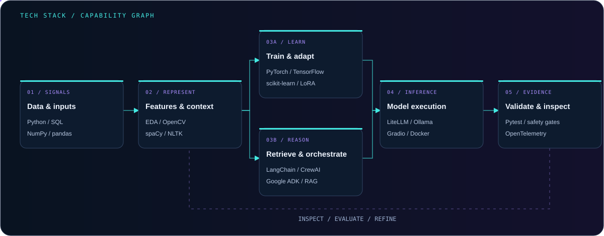</a>

The graph maps my documented tools and areas of work. It is a capability map, not a claim that every project uses every component. **Open a stage to inspect the engineering role of the tools.**

<details>
<summary><b>01 / Signals — acquire, clean, and understand the data</b></summary>

**Python, SQL / MySQL, NumPy, and pandas** support data preparation, exploratory analysis, and feature construction. **Matplotlib and Seaborn** make data quality and behavior visible. My PathLine training included imbalance handling, outliers, skewness, and feature engineering.

The relevant engineering question is not only “Can I load the data?” but “What does a row represent, what is repeated, and what will an aggregation accidentally count twice?” That distinction matters in the Tactical Intelligence Framework.

[](https://pypi.org/project/numpy/)
[](https://pypi.org/project/pandas/)

</details>

<details>
<summary><b>02 / Representation — convert pixels and text into useful signals</b></summary>

**OpenCV and vision transformers** cover visual preprocessing and representation. **spaCy, NLTK, and Gensim** belong to my NLP toolkit; **TF-IDF and dense embeddings** provide different representations for different retrieval and classification problems.

In QORAbot, normalized **MPNet embeddings** feed FAISS retrieval. In the custom sentiment classifier, sparse unigram/bigram features feed Naive Bayes. In Health Guardian, image evidence is recorded separately from the model's interpretation.

[](https://pypi.org/project/transformers/)

</details>

<details>
<summary><b>03A / Learning and adaptation — fit, estimate, and plan</b></summary>

**PyTorch, TensorFlow / Keras, and scikit-learn** support model development. My research interests include **model-based RL, learned dynamics, Kalman filtering, and MCTS**. My documented LLM-adaptation skill set includes **LoRA / QLoRA** and parameter-efficient fine-tuning.

**Quantization** and low-rank adaptation are distinct parts of the efficiency discussion; neither implies a measured latency improvement without a hardware-specific evaluation. The profile does not assign a quantization benchmark to a project that has not published one.

[](https://pypi.org/project/torch/)
[](https://pypi.org/project/scikit-learn/)

</details>

<details>
<summary><b>03B / Agentic reasoning — retrieve, coordinate, and call tools</b></summary>

**LangChain, CrewAI, and Google ADK** are part of my agentic toolkit. **RAG, source metadata, tool schemas, and structured outputs** connect generation to external evidence rather than treating an LLM response as ground truth.

Mooox-Agent emphasizes recursive agent coordination and state continuity. Health Guardian emphasizes function-call normalization and deterministic safeguards. QORAbot emphasizes retrieval and source provenance. These are different engineering contracts—not interchangeable “chatbot” implementations.

[](https://pypi.org/project/langchain/)

</details>

<details>
<summary><b>04 / Inference and execution — connect models to usable systems</b></summary>

**LiteLLM and Ollama** support provider abstraction and local-model workflows in the documented security-agent stack. **Gradio** exposes interactive model interfaces; **Docker** isolates execution. **C / C++** and Linux are part of my broader programming/tooling background.

Inference is more than a model invocation: the input contract, loaded artifacts, tool environment, output schema, and state-handling behavior all affect whether a system is usable. **Latency and throughput should be measured**, not inferred from a demo or an animated dashboard.

[](https://pypi.org/project/gradio/)

</details>

<details>
<summary><b>05 / Evidence and observability — validate before asserting</b></summary>

**Pytest, Pydantic contracts, OpenTelemetry, and explicit audit trails** make failures and outputs inspectable. My project documentation also includes **Poetry**, **Git / GitHub**, and **PostHog** in the engineering toolchain.

I separate regression coverage from model quality, corpus size from training size, and public-leaderboard placement from final ranking. The portfolio uses existing artifacts and clearly scoped results rather than invented benchmark percentages.

[](https://pypi.org/project/pytest/)

</details>

<sub>Release badges query current upstream package versions; they are not my pinned dependency versions or proof of deployment. SVG motion illustrates data flow—it is not live inference telemetry.</sub>

## Featured Projects

### Inspect the systems behind the outputs

Each model card is clickable. Open its engineering brief for the idea, challenge, numeric evidence, technologies, and limitations; follow **Architecture Spec** for the deeper data-flow diagram and original artifacts. Repository-update badges use GitHub data, while notebook and video links are labeled according to what they actually open.

<p align="center">
  <a href="#mooox-agent">Agentic Security</a> &nbsp; / &nbsp;
  <a href="#health-guardian">Medical Safety</a> &nbsp; / &nbsp;
  <a href="#amarzero">Vision + RL</a> &nbsp; / &nbsp;
  <a href="#tactical-intelligence-framework">Tactical Intelligence</a> &nbsp; / &nbsp;
  <a href="#qorabot">Scientific RAG</a> &nbsp; / &nbsp;
  <a href="#sentiment-analysis-app">Applied NLP</a>
</p>


### Mooox-Agent

<a href="./docs/projects/mooox.md">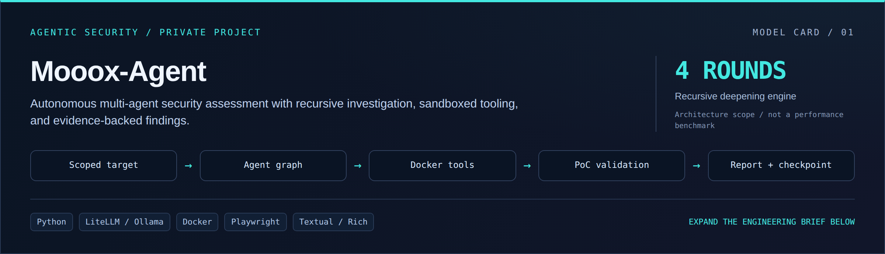</a>

<p><a href="./docs/projects/mooox.md"></a>
<a href="mailto:aammaarrah10@gmail.com"></a></p>

<details>
<summary><b>Open engineering brief — idea / challenge / evidence / stack</b></summary>

**Idea.** I built a multi-agent framework for authorized web security assessments: agents investigate application behavior, share discoveries, and validate suspected vulnerabilities before reporting them.

**Engineering challenge.** Coordinate recursive investigations and heterogeneous tools without losing execution state, confusing unverified findings with evidence, or allowing tooling to escape its intended execution boundary.

**Result and evidence.** A **4-round recursive deepening engine**, with documented checkpoint/resume behavior and a headless CI/CD path. These describe system scope; no public false-positive-rate, precision/recall, latency, or throughput benchmark is claimed.

**Tech stack.** Python · Poetry · LiteLLM · Ollama · Docker / OCI / GHCR · Playwright · Textual / Rich · Pytest · OpenTelemetry · PostHog · Jinja2

**Status and evaluation boundary.** Implementation private. This public architecture summary is based on my project documentation; source code and hosted demo are not publicly available.

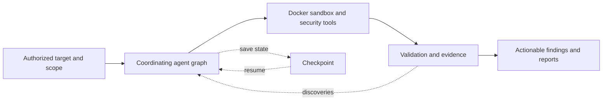

[Inspect the complete architecture and source artifacts](./docs/projects/mooox.md).

</details>

---

### Health Guardian

<a href="./docs/projects/health-guardian.md">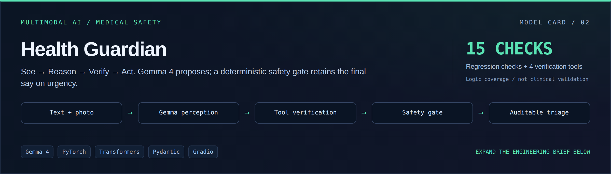</a>

<p><a href="./docs/projects/health-guardian.md"></a>
<a href="https://github.com/amarwahdan/Health-Guardian-AI-safety-agent"></a>
<a href="https://www.kaggle.com/code/amarahmedhamed/health-guardian-ai-safety-agent?scriptVersionId=341035439"></a>
<a href="https://www.kaggle.com/competitions/build-with-gemma-tfug-prayagraj-ai-prayagraj/writeups/health-guardian"></a></p>

[](https://github.com/amarwahdan/Health-Guardian-AI-safety-agent/commits/main)

<details>
<summary><b>Open engineering brief — idea / challenge / evidence / stack</b></summary>

**Idea.** A tool-using medical-safety prototype that separates visible medication-label evidence from reasoning, verifies relevant claims, and returns structured triage with an audit trail.

**Engineering challenge.** Harden stochastic tool calls against multiple wire formats, schema drift, unverified facility names, and under-triage. The deterministic gate may escalate urgency, never downgrade it.

**Result and evidence.** **15 automated mocked regression/sanity checks**, **4 verification tools**, and **5 documented end-to-end examples** in the writeup. These support orchestration behavior—not clinical accuracy or comprehensive medical safety.

**Tech stack.** Python · Gemma 4 · PyTorch · Transformers · Pydantic · Gradio · Pillow

**Status and evaluation boundary.** Functional prototype with small illustrative reference datasets. Not a clinically validated medical device or a replacement for professional care. The demo link opens a public executable notebook, not an always-on endpoint.

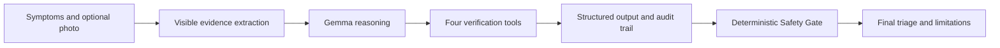

[Inspect the complete architecture and source artifacts](./docs/projects/health-guardian.md).

</details>

---

### AmarZero

<a href="./docs/projects/amarzero.md">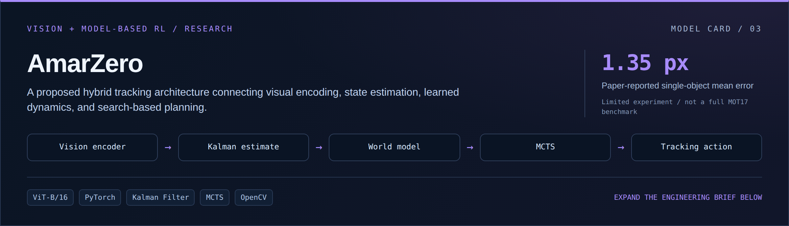</a>

<p><a href="./docs/projects/amarzero.md"></a>
<a href="https://github.com/amarwahdan/AmarZero"></a>
<a href="https://github.com/amarwahdan/AmarZero/blob/main/AmarZero%20paper%20v10.pdf"></a></p>

[](https://github.com/amarwahdan/AmarZero/commits/main)

<details>
<summary><b>Open engineering brief — idea / challenge / evidence / stack</b></summary>

**Idea.** My research prototype explores predictive object tracking and planning through a proposed combination of transformer-based vision, Kalman state estimation, a learned world model, and Monte Carlo Tree Search.

**Engineering challenge.** Connect perception, uncertainty-aware state estimation, transition prediction, and action search in a tracking loop—rather than treating localization as an isolated prediction.

**Result and evidence.** The paper reports **1.35 px single-object** and **2.08 px multi-object** mean error. Checked-in CSVs correspond to limited experiments; see the scope and comparison notes in the architecture brief.

**Tech stack.** Python · PyTorch / torchvision · ViT-B/16 · OpenCV · NumPy / pandas · Kalman filtering · Model-based RL · MCTS

**Status and evaluation boundary.** Research prototype and authored paper. The reported metrics do not establish full-dataset generalization, production real-time throughput, or superiority over every tracker.

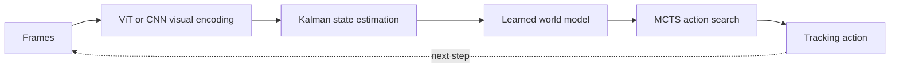

[Inspect the complete architecture and source artifacts](./docs/projects/amarzero.md).

</details>

---

### Tactical Intelligence Framework

<a href="./docs/projects/tactical.md">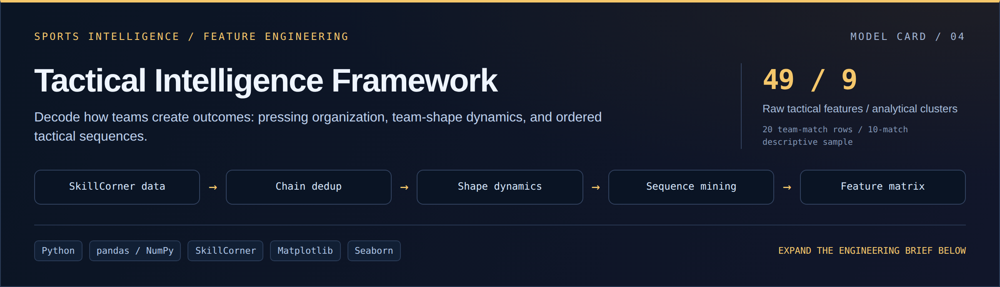</a>

<p><a href="./docs/projects/tactical.md"></a>
<a href="https://github.com/amarwahdan/Tactical-Intelligence-Framework-Decoding-Team-Behavior-Through-Multi-Layer-Soccer"></a>
<a href="https://www.kaggle.com/competitions/soccer-feature-engineering-hackathon/writeups/new-writeup-1778167401935"></a>
<a href="https://youtu.be/fUndffH3uX4"></a></p>

[](https://github.com/amarwahdan/Tactical-Intelligence-Framework-Decoding-Team-Behavior-Through-Multi-Layer-Soccer/commits/main)

<details>
<summary><b>Open engineering brief — idea / challenge / evidence / stack</b></summary>

**Idea.** I engineered interpretable tactical signals that explain team behavior beyond goals and pass totals, combining event aggregation, phase-level shape changes, and ordered multi-event patterns.

**Engineering challenge.** Integrate two heterogeneous data sources without double-counting pressing chains or attacking phases, normalize progression for opposite attacking directions, and detect regain-to-shot sequences in the correct temporal order.

**Result and evidence.** **49 features across 9 clusters**, producing a **20 × 49 feature matrix** from **10 matches**. The writeup reports **0 missing values**; winner/loser patterns are descriptive, not a held-out predictive benchmark.

**Tech stack.** Python · Jupyter · pandas · NumPy · Matplotlib · Seaborn · SkillCorner dynamic_events / phases_of_play

**Status and evaluation boundary.** Feature-engineering research with a published writeup, notebook, CSV artifacts, and video walkthrough. The 10-match sample limits generalization claims.

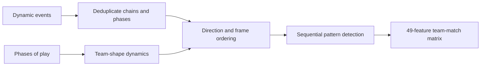

[Inspect the complete architecture and source artifacts](./docs/projects/tactical.md).

</details>

---

### QORAbot

<a href="./docs/projects/qorabot.md">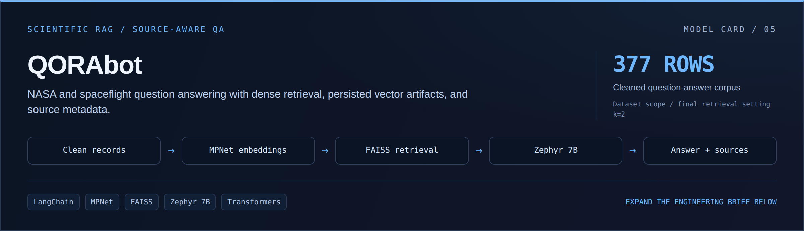</a>

<p><a href="./docs/projects/qorabot.md"></a>
<a href="https://github.com/amarwahdan/-QORAbot-NASA-Research-Chat-System"></a></p>

[](https://github.com/amarwahdan/-QORAbot-NASA-Research-Chat-System/commits/main)

<details>
<summary><b>Open engineering brief — idea / challenge / evidence / stack</b></summary>

**Idea.** A notebook-based RAG system that retrieves NASA/spaceflight content and preserves source URLs alongside generated answers, rather than relying on model memory alone.

**Engineering challenge.** Carry provenance through cleaning, embedding, retrieval, and generation, while constraining answers to retrieved context and handling insufficient evidence explicitly.

**Result and evidence.** A **377-row cleaned corpus**, persisted FAISS artifacts, and final **top-2 retrieval**. These are data/configuration measures; no held-out QA accuracy, faithfulness, or latency score is claimed.

**Tech stack.** Python · pandas · LangChain · sentence-transformers/all-mpnet-base-v2 · FAISS · Hugging Face Transformers · Zephyr-7B-beta

**Status and evaluation boundary.** Public notebook prototype. Source metadata includes heterogeneous references, so the corpus is described as NASA-focused, not exclusively official NASA material.

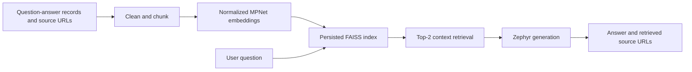

[Inspect the complete architecture and source artifacts](./docs/projects/qorabot.md).

</details>

---

### Sentiment Analysis App

<a href="./docs/projects/sentiment.md">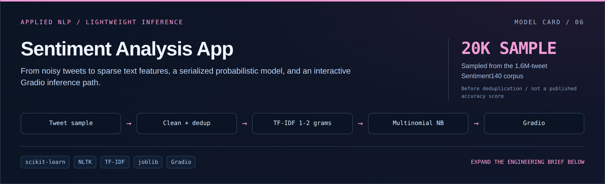</a>

<p><a href="./docs/projects/sentiment.md"></a>
<a href="https://github.com/amarwahdan/Buliding-Sentiment-Analysis-App"></a></p>

[](https://github.com/amarwahdan/Buliding-Sentiment-Analysis-App/commits/main)

<details>
<summary><b>Open engineering brief — idea / challenge / evidence / stack</b></summary>

**Idea.** An end-to-end English tweet classifier covering preprocessing, feature extraction, model fitting, artifact serialization, and interactive inference.

**Engineering challenge.** Remove social-media noise, preserve the fitted vectorizer/model contract at inference, and distinguish the custom classifier from a separate pretrained multilingual demonstration.

**Result and evidence.** **20,000 sampled rows before deduplication**, a TF-IDF cap of **5,000 features**, and an **80/20 split configuration**. Accuracy/F1 outputs are not preserved publicly, so no score is invented.

**Tech stack.** Python · pandas · NLTK · scikit-learn · TF-IDF · Multinomial Naive Bayes · joblib · Gradio · Transformers

**Status and evaluation boundary.** Public source with a local Gradio inference path; no persistent hosted demo is linked. The 1.6M figure describes the source corpus, not the training run.

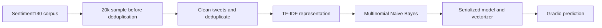

[Inspect the complete architecture and source artifacts](./docs/projects/sentiment.md).

</details>

---

### Smart Healthmeror

<a href="./docs/projects/healthmeror.md">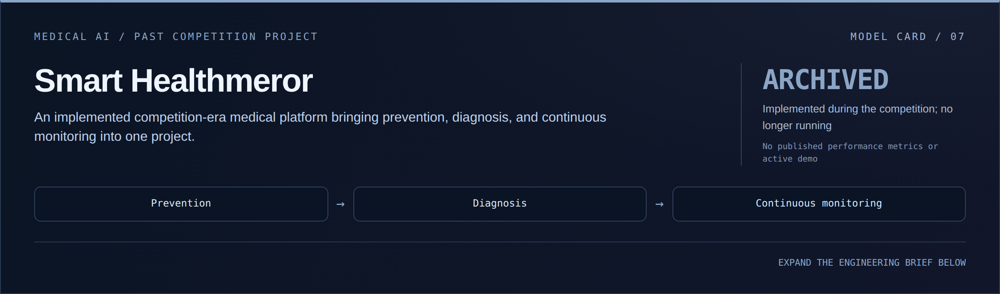</a>

<p><a href="./docs/projects/healthmeror.md"></a>
<a href="mailto:aammaarrah10@gmail.com"></a></p>

<details>
<summary><b>Open engineering brief — idea / challenge / evidence</b></summary>

**Idea.** I built Smart Healthmeror during a competition as an AI-powered medical platform combining prevention, diagnosis, and continuous monitoring. The project is no longer running.

**Engineering challenge.** Bring these three medical-platform functions into a single project experience. The public material does not document the underlying model architecture or evaluation protocol.

**Result and evidence.** **Implemented competition project; now inactive.** No numeric model-performance result or active hosted demo is published.

**Status and evaluation boundary.** Project history confirmed by me. Implementation is no longer running; no public source or performance artifacts are linked.

[Inspect the complete architecture and source artifacts](./docs/projects/healthmeror.md).

</details>

---

## Research and Recognition

### Research artifacts

**AmarZero — Vision-Based RL Agent for Object Tracking & Planning** is my authored research paper on a proposed hybrid vision/state-estimation/world-model/search architecture. The [paper and implementation](https://github.com/amarwahdan/AmarZero) are publicly available; its reported results are scoped in the project brief above.

My **Tactical Intelligence Framework** is published as a [Kaggle writeup](https://doi.org/10.34740/kaggle/w/81727), with feature definitions, methodology, behavioral summaries, and reproducible artifacts. **Health Guardian** has a [published writeup](https://doi.org/10.34740/kaggle/w/109052) documenting its verification workflow and failure-driven hardening. These are research/project publications; no peer-reviewed venue is implied.

### Competition and professional signals

**WiDS Global Datathon 2026 — #34 on the Public Leaderboard**, as reported by me. This is **not a private/final leaderboard rank**. The competition concerns survival analysis for wildfire threat forecasting: right-censoring, time-horizon probabilities, ranking, and calibration. No unreported model score or implementation is attributed to this placement. [Competition](https://www.kaggle.com/competitions/WiDSWorldWide_GlobalDathon26) · [My Kaggle profile](https://www.kaggle.com/amarahmedhamed)

**Kaggle Expert** · **Best Trainee at PathLine** · **GALACTIC PROBLEM SOLVER** · **EliteBridge Award nominee**. Nomination is stated as nomination, not an award win.

<details>
<summary><b>Inspect the WiDS problem framing and ranking distinction</b></summary>

The official challenge asks for the probability that a wildfire reaches within 5 km of an evacuation-zone centroid at 12, 24, 48, and 72 hours, using the first five hours of incident signals. The official evaluation combines C-index and Weighted Brier Score:

```text
Hybrid Score = 0.3 × C-index + 0.7 × (1 − Weighted Brier Score)
```

These are competition requirements, not a description of an unpublished model implementation. Public and private leaderboard rankings are different evaluation snapshots. My stated #34 placement refers specifically to the Public Leaderboard; it must not be read as the final result. [Official overview](https://www.kaggle.com/competitions/WiDSWorldWide_GlobalDathon26/overview)

</details>

## Experience and Learning

**Machine Learning Engineer — hands-on training, PathLine Training Academy**<br />
**May–June 2025 · Cairo, Egypt**

Built TensorFlow image-classification applications, an NLP sentiment-analysis interface, and a Q-learning Tic-Tac-Toe agent. Applied practical preprocessing workflows covering imbalance, outliers, skewness, and feature engineering.

**Information Technology Institute — Artificial Intelligence Academy for Professionals**<br />
Specialized training in **Computer Vision, NLP, and GenAI Engineering**, alongside self-directed study and project work.

<details>
<summary><b>Explore selected learning tracks and certifications</b></summary>

My CV lists 50+ course certifications. Selected areas include **Practical Machine Learning for Data Scientists**, **Deep Learning with PyTorch**, **TensorFlow 2: Sequential APIs**, **Transformers for Computer Vision**, **Natural Language Processing**, **RAG Applications**, **Reinforcement Learning**, **Practical GenAI**, and **Developing GenAI-Powered and Agentic Applications**.

These complement—not replace—the implementation artifacts linked throughout this profile. My working languages are **Arabic** and **English**.

</details>

## Engineering Principles

**The model is one component of the system.** Retrieval, state, tool permissions, execution boundaries, and output contracts deserve as much attention as the model call.

**Verification belongs outside confident prose.** A citation, a tool result, a regression test, and a held-out benchmark answer different questions. I aim to expose those differences rather than hide them behind one accuracy number.

**Failure cases are design inputs.** Parser variance, duplicated events, missing reference data, stale checkpoints, and ambiguous outputs should shape the architecture—not be edited out of the demonstration.

## Repository Signals

<a href="https://github.com/amarwahdan?tab=followers"></a>
<a href="https://github.com/amarwahdan/amarwahdan/commits/main"></a>
<a href="https://github.com/amarwahdan?tab=repositories"></a>

The GitHub badges are activity signals, not model benchmarks or a measure of engineering ability. The core evidence remains the code, writeups, and scoped results.

## Connect

For **AI engineering collaborations, research discussions, or a deeper technical walkthrough**, reach me on [LinkedIn](https://www.linkedin.com/in/amar-ahmed-hamed-25b676302) or at [aammaarrah10@gmail.com](mailto:aammaarrah10@gmail.com). Explore my public experiments and submissions on [Kaggle](https://www.kaggle.com/amarahmedhamed).

<p align="center">
  <a href="#system-profile">Back to System Profile</a> &nbsp; / &nbsp;
  <a href="./docs/profile-design.md">How this README works</a>
</p>

<div align="center">
  
</div>
