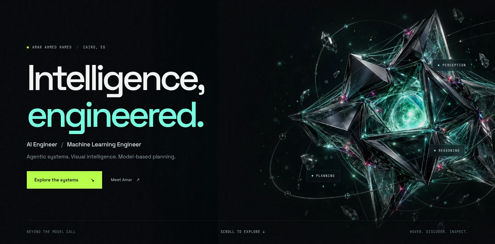
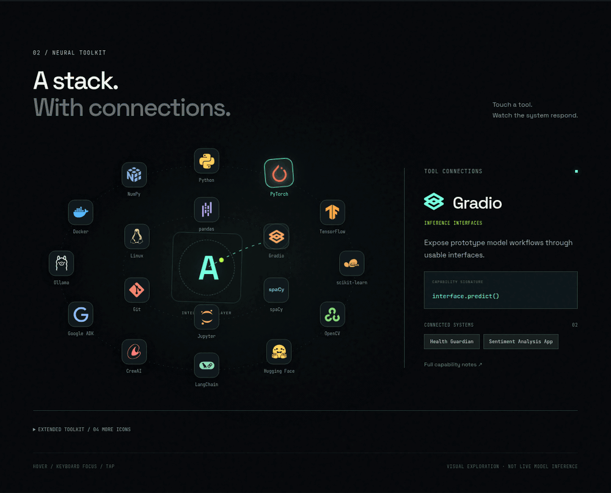
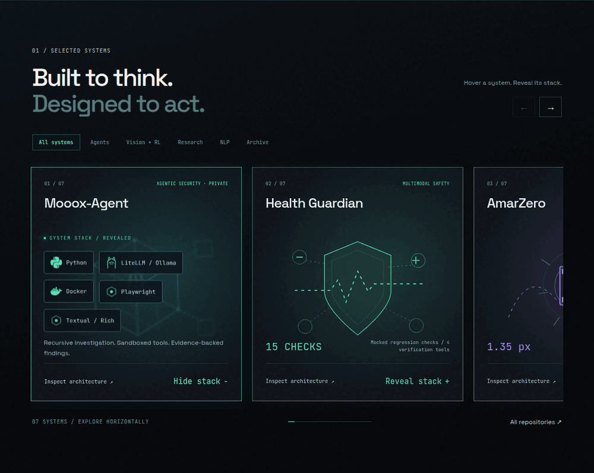
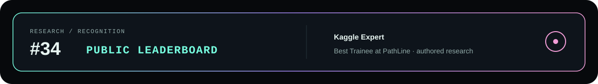

# Amar Ahmed Hamed
**AI Engineer / Machine Learning Engineer**

Hover the tools. Reveal the project stacks. Tap on mobile.

[LinkedIn](https://www.linkedin.com/in/amar-ahmed-hamed-25b676302) · [Email](mailto:aammaarrah10@gmail.com) · [Kaggle](https://www.kaggle.com/amarahmedhamed) · [About me](https://amarai-jzurfwqv.manus.space/about/)

## Neural Toolkit

## Featured Systems

Architecture specs / code / notebooks / research

[Mooox-Agent — private](./docs/projects/mooox.md) · [Health Guardian](./docs/projects/health-guardian.md) · [AmarZero](./docs/projects/amarzero.md) · [Tactical Intelligence](./docs/projects/tactical.md) · [QORAbot](./docs/projects/qorabot.md) · [Sentiment Analysis](./docs/projects/sentiment.md) · [Smart Healthmeror — inactive](./docs/projects/healthmeror.md)

## Research Signals

<a href="https://amarai-jzurfwqv.manus.space/research/">Research &amp; publications ↗</a> · <a href="https://amarai-jzurfwqv.manus.space/about/#experience">Experience ↗</a>

#34 Public Leaderboard: user-reported. Metric scope and project status are documented in the linked briefs. The GIFs demonstrate the interface; live hover and tap interactions run in the portfolio.
