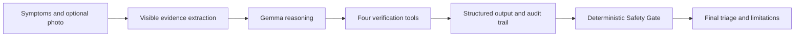

# Health Guardian — Architecture Brief

[Back to profile](../../README.md#featured-projects)

## System purpose

A tool-using medical-safety prototype that separates visible medication-label evidence from reasoning, verifies relevant claims, and returns structured triage with an audit trail.

## Engineering challenge

Harden stochastic tool calls against multiple wire formats, schema drift, unverified facility names, and under-triage. The deterministic gate may escalate urgency, never downgrade it.

## Documented data flow

## Numeric evidence and status

**15 automated mocked regression/sanity checks**, **4 verification tools**, and **5 documented end-to-end examples** in the writeup. These support orchestration behavior—not clinical accuracy or comprehensive medical safety.

Functional prototype with small illustrative reference datasets. Not a clinically validated medical device or a replacement for professional care. The demo link opens a public executable notebook, not an always-on endpoint.

## Technologies

Python · Gemma 4 · PyTorch · Transformers · Pydantic · Gradio · Pillow

### Verification contracts

The four tools check drug interactions, red-flag symptoms, medication information, and demo facilities. `TriageOutput` preserves urgency, evidence, recommended actions, limitations, and tool-call history. `apply_safety_gate` uses verified high-severity evidence to escalate the model's proposal. Urgent/emergency cases with a location are routed through facility lookup rather than relying on a generated facility name.

### Failure-driven hardening

The writeup documents three observed tool-call formats, variable argument keys, an invented facility name, and explicit-null normalization failures. The notebook's mocked regression suite covers parsing, fallback behavior, schema normalization, and escalation. Five illustrated end-to-end questions complement the logic checks; they are demonstrations rather than a held-out clinical test set.

### Data and evaluation boundary

The notebook includes 15 drug-interaction pairs, 8 red-flag patterns, 13 medication records, and 4 demo facilities. These are illustrative references, not exhaustive clinical sources. No sensitivity, specificity, calibration, or per-inference latency benchmark is published. The public Kaggle notebook has a saved successful run; its total notebook runtime must not be interpreted as inference latency.

## Original artifacts

- [Code repository](https://github.com/amarwahdan/Health-Guardian-AI-safety-agent)
- [Public notebook demo](https://www.kaggle.com/code/amarahmedhamed/health-guardian-ai-safety-agent?scriptVersionId=341035439)
- [Paper / writeup](https://www.kaggle.com/competitions/build-with-gemma-tfug-prayagraj-ai-prayagraj/writeups/health-guardian)
- [Implementation notebook](https://github.com/amarwahdan/Health-Guardian-AI-safety-agent/blob/main/src/health-guardian-ai-safety-agent.ipynb)
- [Original architecture image](https://github.com/amarwahdan/Health-Guardian-AI-safety-agent/blob/main/src/Write-up_Img/Health-Guargian_Arch.png)
- [Published Kaggle writeup / DOI](https://doi.org/10.34740/kaggle/w/109052)
