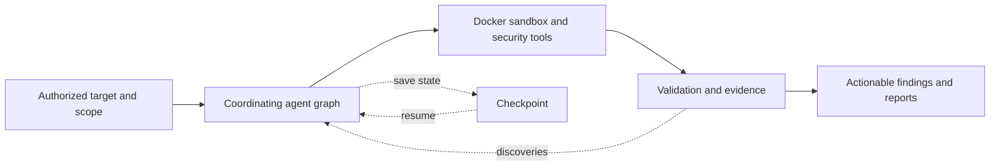

# Mooox-Agent — Architecture Brief

[Back to profile](../../README.md#featured-projects)

## System purpose

I built a multi-agent framework for authorized web security assessments: agents investigate application behavior, share discoveries, and validate suspected vulnerabilities before reporting them.

## Engineering challenge

Coordinate recursive investigations and heterogeneous tools without losing execution state, confusing unverified findings with evidence, or allowing tooling to escape its intended execution boundary.

## Documented data flow

## Numeric evidence and status

A **4-round recursive deepening engine**, with documented checkpoint/resume behavior and a headless CI/CD path. These describe system scope; no public false-positive-rate, precision/recall, latency, or throughput benchmark is claimed.

Implementation private. This public architecture summary is based on my project documentation; source code and hosted demo are not publicly available.

## Technologies

Python · Poetry · LiteLLM · Ollama · Docker / OCI / GHCR · Playwright · Textual / Rich · Pytest · OpenTelemetry · PostHog · Jinja2

### Orchestration and execution

The documented workflow supports local codebases, web applications, and repository-based assessments, with instructions defining scope and exclusions. Specialized agents share discoveries and investigate attack surfaces recursively. Tooling is isolated in a Docker sandbox; the CV documents nuclei, sqlmap, ffuf, and jwt_tool alongside browser automation.

### Continuity and integration

Project documentation describes checkpointing after each agent iteration. Resume restores conversation history, findings, and iteration state, while creating a fresh sandbox. A non-interactive mode is documented for CI/CD integration, including a non-zero exit when vulnerabilities are found. These are documented capabilities, not a public end-to-end reproduction.

### Evidence and boundaries

Finding validation uses proof-of-concept evidence and multi-signal confirmation. There is no published evaluation corpus, named baseline, measured false-positive reduction, or latency/throughput result. Enterprise controls and vendor model recommendations in the private README are not presented here as independently verified features. Security testing must remain limited to systems owned by the operator or explicitly authorized for testing.

## Original artifacts

- [Public contact for project discussion](https://www.linkedin.com/in/amar-ahmed-hamed-25b676302)
