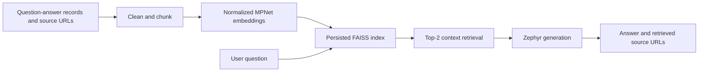

# QORAbot — Architecture Brief

[Back to profile](../../README.md#featured-projects)

## System purpose

A notebook-based RAG system that retrieves NASA/spaceflight content and preserves source URLs alongside generated answers, rather than relying on model memory alone.

## Engineering challenge

Carry provenance through cleaning, embedding, retrieval, and generation, while constraining answers to retrieved context and handling insufficient evidence explicitly.

## Documented data flow

## Numeric evidence and status

A **377-row cleaned corpus**, persisted FAISS artifacts, and final **top-2 retrieval**. These are data/configuration measures; no held-out QA accuracy, faithfulness, or latency score is claimed.

Public notebook prototype. Source metadata includes heterogeneous references, so the corpus is described as NASA-focused, not exclusively official NASA material.

## Technologies

Python · pandas · LangChain · sentence-transformers/all-mpnet-base-v2 · FAISS · Hugging Face Transformers · Zephyr-7B-beta

### Retrieval and generation

The notebook retains category, question, answer, source, and text fields. A recursive splitter is configured with chunk size 800 and overlap 200. `all-mpnet-base-v2` produces normalized embeddings on CPU; FAISS stores the index. The final similarity retriever uses `k=2`. A Transformers pipeline with `HuggingFaceH4/zephyr-7b-beta` generates with a context-only prompt, `max_new_tokens=512`, temperature 0.3, and repetition penalty 1.1.

### Provenance and persistence

LangChain RetrievalQA returns source documents; the helper prints unique source URLs. `index.faiss` and `index.pkl` persist the vector artifacts. The corpus spans ISS (94), Research (90), NASA (79), EVA (71), and NBL (43) records. This preserves retrieval provenance; it does not certify that every cited source is official or that every generated answer is faithful.

### Evaluation boundary

The notebook includes a displayed manual query, but no public held-out QA set, retrieval-recall benchmark, human faithfulness evaluation, baseline comparison, or per-inference latency measurement. No persistent hosted application endpoint is linked.

## Original artifacts

- [Code repository](https://github.com/amarwahdan/-QORAbot-NASA-Research-Chat-System)
- [Implementation notebook](https://github.com/amarwahdan/-QORAbot-NASA-Research-Chat-System/blob/main/src/QORAbot%20.ipynb)
- [Persisted vector artifacts](https://github.com/amarwahdan/-QORAbot-NASA-Research-Chat-System/tree/main/src/Vector_Database)
