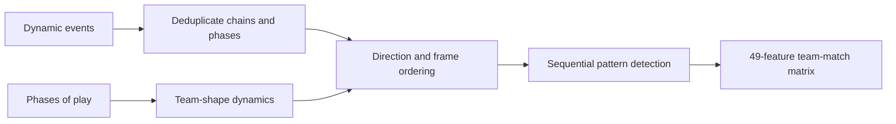

# Tactical Intelligence Framework — Architecture Brief

[Back to profile](../../README.md#featured-projects)

## System purpose

I engineered interpretable tactical signals that explain team behavior beyond goals and pass totals, combining event aggregation, phase-level shape changes, and ordered multi-event patterns.

## Engineering challenge

Integrate two heterogeneous data sources without double-counting pressing chains or attacking phases, normalize progression for opposite attacking directions, and detect regain-to-shot sequences in the correct temporal order.

## Documented data flow

## Numeric evidence and status

**49 features across 9 clusters**, producing a **20 × 49 feature matrix** from **10 matches**. The writeup reports **0 missing values**; winner/loser patterns are descriptive, not a held-out predictive benchmark.

Feature-engineering research with a published writeup, notebook, CSV artifacts, and video walkthrough. The 10-match sample limits generalization claims.

## Technologies

Python · Jupyter · pandas · NumPy · Matplotlib · Seaborn · SkillCorner dynamic_events / phases_of_play

### Three analytical layers

The pipeline moves from event aggregation to phase-level shape dynamics and sequence detection. `dynamic_events.csv` and `phases_of_play.csv` are the two documented calculation inputs. Pressing chains are deduplicated by chain identity, progression is normalized by attacking direction, and sequencing uses `frame_start` because `time_start` is unpopulated. Raw outputs are counts, sums, distances, and durations rather than normalized performance scores.

### Nine clusters

Pressing Architecture (7), Defensive Shape and Quality (9), Territorial Control (7), Ball Progression (6), Attacking Threat (5), Off-Ball Movement (4), Physical Dynamics (3), Game State and Defense (2), and Sequence Intelligence (6). The final cluster links ordered actions, including regain-ending pressing chains followed by a possession phase leading to a shot.

### Outputs and interpretation

The generated CSV has 20 team-match rows for 10 matches and 49 feature columns, with match/team identifier columns in addition. The writeup reports 0 missing values. For example, winners/losers average 17.1/10.9 regain chains and 37.8/25.1 events leading to a shot. These are descriptive within-sample averages, not causal effects, classifier accuracy, or external validation. Pitch-size variation and small sample size are acknowledged in the writeup.

## Original artifacts

- [Code repository](https://github.com/amarwahdan/Tactical-Intelligence-Framework-Decoding-Team-Behavior-Through-Multi-Layer-Soccer)
- [Paper / writeup](https://www.kaggle.com/competitions/soccer-feature-engineering-hackathon/writeups/new-writeup-1778167401935)
- [Video walkthrough](https://youtu.be/fUndffH3uX4)
- [Implementation notebook](https://github.com/amarwahdan/Tactical-Intelligence-Framework-Decoding-Team-Behavior-Through-Multi-Layer-Soccer/blob/main/src/Tactical%20Intelligence%20Framework.ipynb)
- [Generated feature matrix](https://github.com/amarwahdan/Tactical-Intelligence-Framework-Decoding-Team-Behavior-Through-Multi-Layer-Soccer/blob/main/src/Result/features.csv)
- [Published Kaggle writeup / DOI](https://doi.org/10.34740/kaggle/w/81727)
