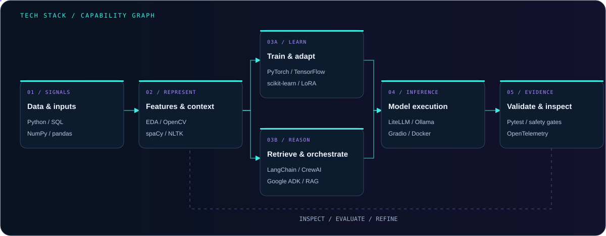
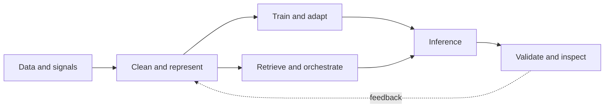

# Tech Stack — AI Capability Pipeline

[Back to profile](../README.md#tech-stack)

This graph organizes Amar Ahmed Hamed's documented skills and project tooling into engineering roles. It is not a single deployed architecture, and it does not imply that all listed technologies appear in every project.

## Signals and representation

Python, SQL/MySQL, NumPy, and pandas support data processing and feature engineering. Matplotlib and Seaborn support inspection. OpenCV and visual encoders address image representation; spaCy, NLTK, and Gensim belong to the NLP toolkit. Sparse TF-IDF and dense MPNet embeddings appear in different portfolio implementations and should not be treated as the same representation.

## Learning and adaptation

PyTorch, TensorFlow/Keras, and scikit-learn support model development. Model-based reinforcement learning, Kalman filtering, learned dynamics, and MCTS are central to the AmarZero research design. LoRA/QLoRA are documented adaptation skills; no hardware-specific quantization speedup is claimed by this capability map.

## Retrieval and agentic orchestration

LangChain, CrewAI, Google ADK, RAG, structured function calls, and source metadata belong to the agentic skill set. Per-project contracts differ: Mooox-Agent documents recursive investigations and resumable state; Health Guardian implements a verification/safety layer; QORAbot persists retrieval artifacts and source URLs.

## Inference and execution

LiteLLM/Ollama are documented in the private security-agent stack. Gradio exposes notebook/local model interfaces. Docker isolates tooling. C/C++, Linux, Git/GitHub, and Poetry are part of the broader engineering toolchain. Latency, throughput, model size, and memory use require separately scoped measurements; animated flow is not evidence of any of them.

## Validation and observability

Pytest, Pydantic, safety gates, OpenTelemetry, PostHog, and explicit output artifacts serve different testability and observability roles. A regression check is not an accuracy score; source provenance is not a faithfulness benchmark; activity badges are not system health telemetry.

## Dynamic badge meaning

The README's package badges query upstream releases through Shields.io. They do not claim pinned project versions. Repository-update badges query actual GitHub commits and may be cached by image providers. The visual sources contain no JavaScript or private credentials.
